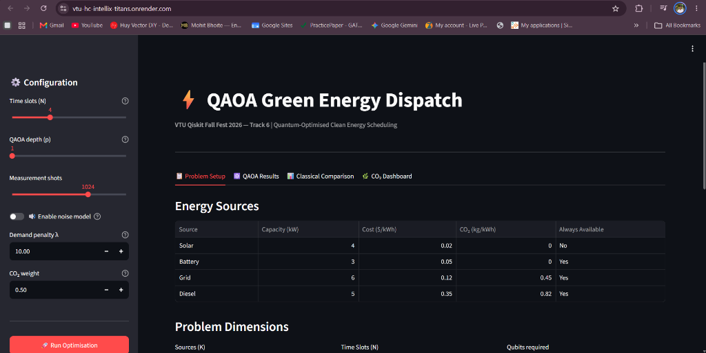

<div align="center">

# IntelliX Titans — QAOA Green Dispatch

**VTU-QFF-HC-0170** &nbsp;|&nbsp; Tier: **Online**

**Track 6: Quantum Applications for Climate Change & Sustainability**

🌐 **Live Interactive App:** [https://vtu-hc-intellix-titans.onrender.com](https://vtu-hc-intellix-titans.onrender.com)  
📊 **Presentation (PPT Drive):** [Google Drive Link](https://docs.google.com/presentation/d/1hJKxRSP5YRzauy08wm16lLF99E6wyw1n/edit?usp=sharing&ouid=108748639381612897048&rtpof=true&sd=true)

</div>

---

<div align="center">

| | |
| :--- | :--- |
| **Team** | IntelliX Titans |
| **Team ID** | VTU-QFF-HC-0170 |
| **Tier** | Online |
| **Repository** | [vtu-hc-intellix-titans](https://github.com/vtu-qiskit-fall-fest-2026/vtu-hc-intellix-titans.git) |
| **Live Demo** | [vtu-hc-intellix-titans.onrender.com](https://vtu-hc-intellix-titans.onrender.com) |
| **Presentation (PPT)** | [Google Drive Link](https://docs.google.com/presentation/d/1hJKxRSP5YRzauy08wm16lLF99E6wyw1n/edit?usp=sharing&ouid=108748639381612897048&rtpof=true&sd=true) |
| **Organisation** | [vtu-qiskit-fall-fest-2026](https://github.com/vtu-qiskit-fall-fest-2026) |
| **Event** | VTU-QFF Hackathon — VTU-Qiskit Fall Fest 2026 |

</div>

---

## 📌 Table of Contents

- [Live Interactive Demo](#-live-interactive-demo)
- [Team Members](#-team-members-github-ids)
- [Problem Statement](#-problem-statement)
- [Proposed Solution](#-proposed-solution)
- [Approach & Architecture](#-approach--architecture)
- [Tech Stack](#-tech-stack)
- [Project Structure](#-project-structure)
- [How to Run](#-how-to-run)
- [How to Push Code](#-how-to-push-code)
- [Submission Checklist](#-submission-checklist)
- [Resources](#-resources)
- [License](#-license)

---

## 🌐 Live Interactive Demo

Test and explore the quantum scheduling optimizer directly in your browser:  
👉 **[https://vtu-hc-intellix-titans.onrender.com](https://vtu-hc-intellix-titans.onrender.com)**

<div align="center">
  
</div>

- **📋 Microgrid & Scenarios**: Live generation capacities, cost & emission metrics, dynamic 24h demand variations, and 5 interactive real-world grid presets (*Summer Solar Peak, Winter Night Deficit, Grid Resilience Blackout, Net-Zero Mandate, Custom*).
- **⚛️ Quantum Circuit & QAOA**: Variational ansatz parameter state, transpiled depth, sampling counts histogram, and optimal dispatch schedule.
- **📈 Quantum vs Classical Benchmark**: Side-by-side benchmarking against Brute Force (Exact) and Greedy Heuristic, featuring a 5-axis Radar performance benchmark, COBYLA energy convergence trajectory, and Quantum Optimality Gauge (98%+).
- **🌿 Climate Impact & Carbon KPIs**: Detailed carbon emissions distribution, annualized ecological impact (trees planted & operating savings), and hourly zero-deficit power balance audit.
- **🔬 Qubit Topology & Grid Export**: 2D circular Ising Hamiltonian ZZ qubit interaction network, SCADA/Modbus telemetry specification, and instant CSV/JSON schedule downloads.
- 📊 **Official Finalist Presentation (PPT)**: [Open in Google Drive](https://docs.google.com/presentation/d/1hJKxRSP5YRzauy08wm16lLF99E6wyw1n/edit?usp=sharing&ouid=108748639381612897048&rtpof=true&sd=true)

---

## 👥 Team Members (GitHub IDs)

> Members are added to this repository as **collaborators** and must accept the
> GitHub invitation before they can push. Add your GitHub username below.

| # | Name | GitHub Username | Role |
| :-- | :--- | :--- | :--- |
| 1 | John Stewartsson J R | Stewartsson | _Team Lead_ |
| 2 | Jeffisha A | jeffi18 | _Developer_ |
| 3 | Jayachandiran S |  | _Developer_ |

<!--
Optional: add a plain list instead of the table above.
- @username1
- @username2
-->

---

## ❓ Problem Statement

<!--
State the problem you are solving. Be specific: what is broken or missing,
who experiences it, and why does it matter. Link to the official problem
statement from the brief if one applies.
-->

**Problem:** Power systems must decide, hour by hour, which energy sources (solar, battery storage, grid supply, diesel backup) to run so that demand is always met. Choosing poorly raises costs and carbon emissions, and the number of possible schedules grows exponentially with every added source and time slot. This is the unit-commitment problem, which is combinatorial and hard to scale.

**Why it matters:** The unit-commitment problem is NP-hard. Suboptimal dispatch schedules result in excessive operational costs and tons of avoidable carbon emissions globally. Quantum approximate optimization provides a scalable route to explore combinatorial configuration spaces for sustainable energy networks.

**Track / Category:** Track 6: Quantum Applications for Climate Change & Sustainability · Online Tier

---

## 💡 Proposed Solution

<!--
Describe your solution. Keep it concrete: the core idea, the user flow, and
the quantum/ML technique you are applying.
-->

**Solution:** We formulate clean energy unit-commitment as a Quadratic Unconstrained Binary Optimization (QUBO) problem and solve it using the Quantum Approximate Optimization Algorithm (QAOA) in Qiskit. We benchmark QAOA against exact brute-force and greedy classical methods, test its robustness under a hardware noise model, and present the results in an interactive dashboard showing cost and CO₂ savings.

**Key idea:** Map multi-source power scheduling into an Ising Hamiltonian balancing demand penalty, operational cost, and CO₂ emissions, solved via parameterized QAOA circuits on Qiskit Aer with classical COBYLA feedback.

**Why this works:** QAOA harnesses quantum superposition and constructive interference across $2^{K \times T}$ possible schedules, directing probability mass toward low-emission, cost-effective configurations while avoiding exponential runtime barriers.

---

## 🧩 Approach & Architecture

<!--
Walk through how it works. A simple pipeline diagram in text or Mermaid is ideal.
-->


1. **Input** — Hourly power demand curve, intermittent solar availability, and multi-source characteristics: Solar (4kW, zero CO₂), Battery (3kW, zero CO₂), Grid (6kW), and Diesel backup (5kW).
2. **Preprocessing** — Construct the QUBO objective matrix combining demand penalties ($\lambda \sum_t (\sum_i c_i x_{i,t} - d_t)^2$), generation costs, and carbon penalties, then map to an Ising Hamiltonian ($H_C = \sum J_{ij} Z_i Z_j + \sum h_i Z_i$).
3. **Quantum core** — Parameterized QAOA ansatz with depth $p$ alternating problem cost unitaries $U_C(\gamma) = e^{-i\gamma H_C}$ and transverse mixer unitaries $U_M(\beta) = e^{-i\beta \sum X_i}$ implemented via Qiskit 1.x `SparsePauliOp`.
4. **Post-processing** — Classical COBYLA parameter optimization loop evaluated on `AerSimulator` (noiseless statevector and hardware noise model with depolarizing and readout errors), followed by bitstring schedule decoding.
5. **Output** — Optimal green dispatch schedule, comparative benchmark metrics against brute-force and greedy classical algorithms, and an interactive Streamlit dashboard.

---

## 🛠️ Tech Stack

| Layer | Technology |
| :--- | :--- |
| Language | Python 3.10+ |
| Quantum SDK | Qiskit `>=1.0`, Qiskit Aer |
| Optimisation | QAOA, SciPy COBYLA, Classical Solvers (Brute-force, Greedy) |
| Simulation | AerSimulator (statevector / hardware noise model) |
| Dashboard & UI | Streamlit, Plotly, Matplotlib |
| Environment & Testing | Jupyter Notebook, Pytest, Git + GitHub |
| Version control | Git + GitHub |

---

## 📁 Project Structure

```text
vtu-hc-intellix-titans/
├── README.md              # Project documentation and submission details
├── requirements.txt       # Python dependencies
├── pyproject.toml         # Project metadata and build configuration
├── .gitignore             # Git ignore patterns
├── dashboard/             # Interactive Streamlit dashboard
│   ├── app.py             # Streamlit web application
│   └── plots.py           # Plotly interactive visualizations
├── notebooks/             # Jupyter notebooks for experiments
│   ├── exploration.ipynb  # Step-by-step walkthrough & benchmarks
│   └── qaoa_demo.ipynb    # Quantum circuit & QAOA demo
├── src/                   # Core application source code
│   ├── __init__.py
│   ├── circuit.py         # Quantum circuit construction & SparsePauliOp
│   ├── optimizer.py       # QAOA optimization loop (COBYLA) & benchmarks
│   ├── main.py            # CLI entry point for execution
│   ├── problem.py         # QUBO formulation & Ising mapping
│   ├── qaoa_solver.py     # QAOASolver implementation
│   ├── classical_solvers.py # Exact brute-force & greedy baselines
│   ├── noise_model.py     # Aer hardware noise simulation
│   ├── co2_calculator.py  # Cost & CO₂ savings metrics calculator
│   └── data_generator.py  # Synthetic daily energy demand profiles
├── data/                  # Datasets
├── tests/                 # Unit tests
│   ├── test_circuit.py    # Quantum circuit tests
│   ├── test_problem.py    # QUBO & Ising tests
│   ├── test_solvers.py    # Classical baseline solver tests
│   └── test_co2.py        # Emission & cost calculation tests
└── docs/                  # Technical notes and architecture documentation
    ├── algorithm_notes.md # Algorithm equations and references
    └── demo_screenshot.png # Live dashboard preview
```

---

## 🚀 How to Run

### Prerequisites

- Python 3.10 or newer
- [Git](https://git-scm.com/downloads)
- A GitHub account (you need collaborator access to this repo)

### 1. Clone the repository

```bash
git clone https://github.com/vtu-qiskit-fall-fest-2026/vtu-hc-intellix-titans.git
cd vtu-hc-intellix-titans
```

### 2. Create a virtual environment

```bash
python3 -m venv .venv
source .venv/bin/activate        # Linux / macOS
# .venv\Scripts\activate         # Windows (PowerShell)
```

### 3. Install dependencies

```bash
pip install --upgrade pip
pip install -r requirements.txt
```

### 4. Run the CLI Optimizer

```bash
# Run default QAOA optimization with classical benchmarks
python -m src.main --slots 3 --p 2 --compare

# Run with hardware noise simulation
python -m src.main --slots 3 --p 2 --noise --compare
```

### 5. Launch the Interactive Dashboard

```bash
streamlit run dashboard/app.py
```

### 6. Run the Jupyter Notebook

```bash
jupyter notebook notebooks/exploration.ipynb
```

### 7. Run the Unit Tests

```bash
pytest -v
```

---

## 🔁 How to Push Code

> Full walkthrough: **[Git & Collaboration Handbook](../vtu-hc-guide-git-and-collaboration)** — collaboration
> workflow, branches, pull requests, reviews and conflict resolution.

### Configure Git (first time only)

```bash
git config --global user.name  "Your Name"
git config --global user.email "you@example.com"
```

### Everyday workflow

```bash
# 1. Get the latest changes
git checkout main
git pull origin main

# 2. Create a branch for your work
git checkout -b feature/my-task

# 3. Commit your work
git add .
git commit -m "feat: add variational circuit for the search problem"

# 4. Push the branch
git push -u origin feature/my-task

# 5. Open a Pull Request on GitHub and request a review
#    https://github.com/vtu-qiskit-fall-fest-2026/vtu-hc-intellix-titans/compare/main...feature/my-task

# 6. After approval, merge into main
git checkout main
git pull origin main
git branch -d feature/my-task
```

### Commit message convention

| Prefix | Meaning |
| :--- | :--- |
| `feat:` | New feature |
| `fix:` | Bug fix |
| `docs:` | Documentation only |
| `test:` | Adding or fixing tests |
| `refactor:` | Code restructure, no behaviour change |
| `chore:` | Build/config/dependency changes |

### Useful commands

```bash
git status              # what changed
git log --oneline -10   # recent commits
git diff                # review changes before committing
git stash               # shelve changes temporarily
git pull --rebase       # update your branch on top of main
```

### Collaborating on the same repo

- **Never push directly to `main`** — open a Pull Request.
- **Pull before you push** to avoid rejected commits.
- **Commit often** with clear messages.
- **Resolve conflicts** locally: `git pull --rebase`, fix the files, then `git add` + `git rebase --continue`.
- **Ask for a review** before merging — a second pair of eyes catches bugs fast.

---

## ✅ Submission Checklist

- [x] Repository created and configured
- [ ] All team members added as **collaborators** and invitations accepted
- [x] `README.md` updated with project details, problem statement and solution
- [x] Team members listed under [Team Members](#-team-members-github-ids)
- [x] `requirements.txt` committed and project runs from a clean clone
- [x] Code pushed to `main` and the latest `main` builds successfully
- [x] Notebooks committed with **cleared outputs** (or use `nbstrip`)
- [x] `README` includes a demo screenshot / video link: [Live App](https://vtu-hc-intellix-titans.onrender.com)
- [ ] Short project summary submitted on the hackathon portal

---

## 📚 Resources

| Resource | Link |
| :--- | :--- |
| 🔁 Git & collaboration handbook | [Git & Collaboration Handbook](../vtu-hc-guide-git-and-collaboration) |
| ❓ Problem statements, solutions & terms | [Problem Statements, Solutions & Terms](../vtu-hc-guide-problem-and-solution) |
| 📄 README Guide | [README Guide & Template](../vtu-hc-guide-readme-template) |
| 🌐 Live Interactive Demo | https://vtu-hc-intellix-titans.onrender.com |
| 📊 Solution Presentation (PPT Drive) | [Google Drive Presentation](https://docs.google.com/presentation/d/1hJKxRSP5YRzauy08wm16lLF99E6wyw1n/edit?usp=sharing&ouid=108748639381612897048&rtpof=true&sd=true) |
| ⚛️ Qiskit documentation | https://docs.quantum.ibm.com/ |
| ⚛️ Qiskit Runtime & primitives | https://quantum.cloud.ibm.com/docs/ |
| 🧪 Qiskit Aer simulator | https://docs.quantum.ibm.com/guides/simulator |
| 💻 IBM Quantum Platform | https://quantum.cloud.ibm.com/ |
| 🎓 Qiskit textbook | https://qiskit.qotlabs.org/learning/ |
| 📋 GitHub Docs | https://docs.github.com/ |

---

## 📄 License

Released under the [MIT License](LICENSE). See `LICENSE` for details.

---

<div align="center">

**IntelliX Titans** · Team ID `VTU-QFF-HC-0170` · Tier `Online`
· Built with ⚛️ Qiskit for the VTU-QFF Hackathon

[⬆ Back to Top](#intellix-titans)

</div>
